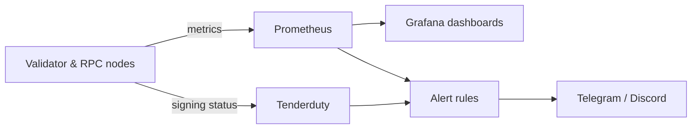

**Independent non-custodial validator since 2021 — high security, superior uptime, built and run from Indonesia 🇮🇩**

---

## 👋 About Me

Hi, I'm the one-person team behind **Indonode**. Since 2021 I've been running non-custodial validators and public infrastructure across a range of blockchain networks, with deep roots in the **Cosmos ecosystem**.

I like getting involved early: joining testnets, helping networks reach mainnet, and keeping the infrastructure running that node operators and communities depend on, whatever chain they're built on.

- 🛡️ Independent, **non-custodial** validator since **2021**
- 🔭 Maintainer of the **[Indonode Multi-chain Explorer](https://explorer.indonode.net)**
- 📚 Node guides & documentation at **[indonode.net](https://indonode.net)**

> **Reliability is not a feature. It is the foundation.**
> Everything I run is built to be **Secure → Observable → Automated → Resilient → Maintainable.**

---

## 🛰️ What I Run

| Area | What it includes |
|---|---|
| **Validation** | Mainnet & testnet validators across Cosmos SDK / CometBFT and other networks · secure key management · automated upgrades |
| **Public infrastructure** | RPC & API endpoints · state sync · snapshots · custom pruning · multi-chain explorer |
| **Server operations** | Hardened Linux · UFW firewalling · Nginx reverse proxy with TLS · Docker · automated deployment scripts |
| **Monitoring & alerting** | Prometheus · Grafana · Tenderduty · Telegram & Discord alerts · custom health checks |

---

## 📡 How I Monitor

I watch every node around the clock for block signing, missed blocks, peer connectivity, sync status, system resources, and endpoint availability, so I catch issues before they turn into downtime.

---

## 🌐 Networks I've Supported

<table>
  <tr>
    <td align="center">Artela</td>
    <td align="center">Axone</td>
    <td align="center">Band Protocol</td>
  </tr>
  <tr>
    <td align="center">BitCanna</td>
    <td align="center">BlockX</td>
    <td align="center">Celestia</td>
  </tr>
  <tr>
    <td align="center">Chain4Energy</td>
    <td align="center">Dymension</td>
    <td align="center">Entangle</td>
  </tr>
  <tr>
    <td align="center">Entrypoint</td>
    <td align="center">Hypersign</td>
    <td align="center">Initia</td>
  </tr>
  <tr>
    <td align="center">Planq</td>
    <td align="center">Point Network</td>
    <td align="center">Quasar</td>
  </tr>
  <tr>
    <td align="center">Quicksilver</td>
    <td align="center">Realio</td>
    <td align="center">Self Chain</td>
  </tr>
  <tr>
    <td align="center">Shido</td>
    <td align="center">Source Protocol</td>
    <td align="center">Swisstronik</td>
  </tr>
</table>

My work on these networks includes mainnet and testnet validation, infrastructure deployment, monitoring, and community support.

---

## 🧰 Tech Stack

**Operations & Infrastructure**

**Monitoring**

**Languages & Data**

---

## 📊 GitHub Activity

---

## 🤝 Work With Me

Want to **delegate** to a validator who keeps your keys yours, need **reliable RPC endpoints**, or **launching a testnet** and want an experienced operator on board? I'd love to hear from you.

[**Website**](https://indonode.net) · [**Email**](mailto:contact@indonode.net) · [**Multi-chain Explorer**](https://explorer.indonode.net) · **Discord:** `flux_en`

